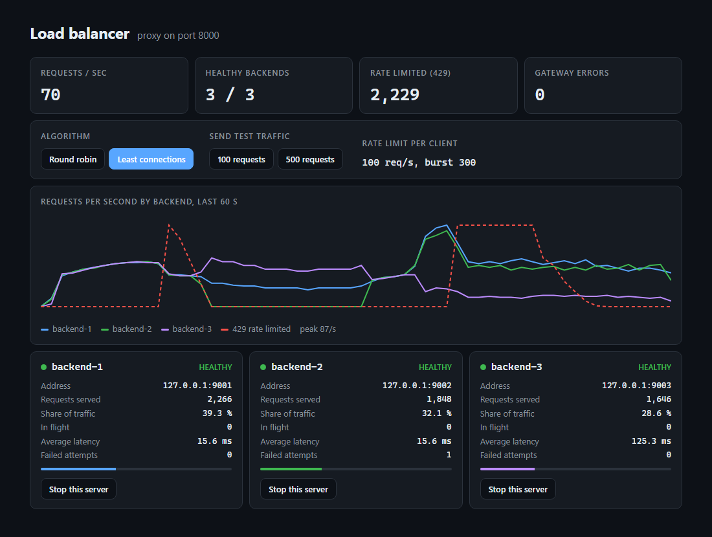

# Load Balancer with Rate Limiting

An HTTP load balancer written from scratch in Java 21. It spreads requests across several
backend servers, takes failed servers out of rotation, limits how fast each client may send
requests, and comes with a live dashboard.

No runtime dependencies. Only the JDK.



What the screenshot shows, left to right:

1. `backend-2` (green) is stopped. Its line drops to zero and the other two absorb the
   traffic, with no gateway errors.
2. It is started again and rejoins after two successful health checks.
3. The algorithm is switched to least connections. `backend-3` (purple) answers in 125 ms
   instead of 15 ms, so it now receives fewer requests.
4. The red dashed line marks requests rejected with `429` when the client exceeded its limit.

## Features

- Reverse proxy for any HTTP method, path, query string and body
- Two algorithms, switchable at runtime: round robin and least connections
- Active health checks (`GET /health`) with hysteresis, plus passive detection on real traffic
- Automatic retry on another backend, but only when repeating the request is safe
- Token bucket rate limiter per client IP, answering `429` with a `Retry-After` header
- Dashboard with per-backend throughput, latency and controls

## Run

Requires JDK 21 and Maven.

```bash
mvn package
```

Start with three built-in demo backends (one is deliberately slow):

```bash
java -jar target/load-balancer-1.0.0.jar
```

The proxy listens on <http://127.0.0.1:8000> and the dashboard on <http://127.0.0.1:8001>.
From the dashboard you can stop a demo server, switch algorithm and send test traffic.

Use your own backends:

```bash
java -jar target/load-balancer-1.0.0.jar --backend http://127.0.0.1:9001 --backend http://127.0.0.1:9002
```

| Option | Default | Meaning |
|---|---|---|
| `--backend <url>` | demo servers | Upstream server, repeat per server |
| `--port <n>` | 8000 | Proxy port |
| `--admin <n>` | 8001 | Dashboard port, loopback only |
| `--bind <address>` | 127.0.0.1 | Proxy bind address |
| `--algorithm <name>` | round-robin | `round-robin` or `least-connections` |
| `--rate <n>` | 50 | Requests per second per client IP, `0` disables |
| `--burst <n>` | 100 | Bucket size: how many requests a client may send at once |
| `--health <seconds>` | 2 | Interval between health checks |

## Design

```
LoadBalancer  accepts requests, applies the rate limit, forwards, retries
  RateLimiter token bucket per client IP
  Balancer    picks a healthy backend (round robin / least connections)
  Backend     address, health state, in-flight count, counters
Admin         dashboard and control API
DemoBackend   tiny upstream server for trying things out
```

## Details that were not obvious

- **When a retry is safe.** If a backend fails, sending the request to another one sounds
  harmless, but a `POST /pay` might already have been processed before the connection broke.
  The proxy retries any method if the connection was *never established* (the backend saw
  nothing), and after that point only idempotent methods (`GET`, `HEAD`, `PUT`, `DELETE`,
  `OPTIONS`).
- **Health checks need hysteresis.** A server is marked down or up only after two
  consecutive results that disagree with its current state. Otherwise a single slow response
  removes a healthy server, and a single lucky one brings a broken server back.
- **Passive checks react faster than active ones.** If a real request cannot connect, the
  backend is removed immediately instead of waiting for the next health check. Coming back
  still requires passing the active checks.
- **Rate limit by socket address, not by header.** `X-Forwarded-For` is set by the client and
  can contain anything. Using it as the rate limit key would let anyone avoid the limit by
  sending a different value each time.
- **Token bucket without a timer.** Tokens are not added by a background thread. Each bucket
  stores a count and a timestamp, and the refill is computed when the next request arrives.
- **Evicting idle clients is lossless.** A bucket that has refilled completely behaves
  exactly like a bucket that does not exist, so full buckets are dropped. The map cannot grow
  with every IP address ever seen, and no client gets extra tokens from the eviction.
- **Hop-by-hop headers.** `Connection`, `Keep-Alive`, `Transfer-Encoding` and similar headers
  describe one connection, not the request, and are not forwarded. Headers listed inside the
  `Connection` header are dropped too.
- **Only the path is taken from the request line.** A request such as
  `GET http://internal-host/admin HTTP/1.1` must not make the proxy contact another host.
- **Redirects are relayed, not followed.** A `302` from a backend goes back to the client.
- **Fair ties.** With least connections, idle backends all have zero connections. The scan
  starts at a rotating position so the first server in the list does not get every request.

## Tests

```bash
mvn test
```

21 tests: the rate limiter with a fake clock, backend selection and health state, and
integration tests where the proxy runs against real HTTP servers, including one that accepts
a connection and hangs up without answering.

## Limitations

- Request and response bodies are buffered in memory (10 MB request limit). This is what
  makes retries possible, but it is not suitable for large uploads or streaming.
- HTTP/1.1 and plain HTTP only. No TLS termination, WebSocket or HTTP/2.
- No sticky sessions and no weighted backends.
- The rate limiter lives in one process. Several balancer instances would need shared state.

## License

MIT
